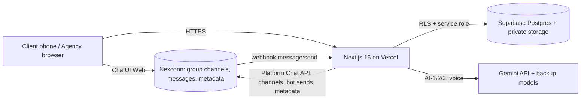

# Drifty: submission write-up

> **Indian agencies run client approvals on WhatsApp. Drifty is a Nexconn-powered chat room where
> clients talk naturally (even Hinglish voice notes); AI turns it into a change list, catches
> conflicting feedback and missed changes, and records a dispute-proof approval.**

| | |
| --- | --- |
| Live app | https://drifty-six.vercel.app |
| GitHub | https://github.com/Neitikjangra/drifty |
| Demo video | _(fill in)_ |
| Nexconn App Key | _(fill in from the Nexconn Console; the public client key, not the App Secret)_ |
| Try-it QR | _(make one for https://drifty-six.vercel.app with any QR generator and paste it here)_ |

## 1. Problem and evidence

Feedback on creative work arrives scattered across WhatsApp threads, screenshots and voice notes.
The costly failures repeat: a request gets lost, two client people ask for opposite things, the next
version quietly misses a change, and later "I never approved that". (Sources: docs/SRS.md section 2.)

- Revision rounds before approval rose from three (2007) to five, and only a third of agencies say
  they get constructive feedback ([Marketing Week, on the IPA / BetterBriefs study](https://www.marketingweek.com/constructive-feedback-ipa/)).
- AI that consolidates feedback is sold today as 3–5-week custom builds ([Enterprise DNA](https://enterprisedna.co/resources/guides/agencies-automate-client-revision-tracking)):
  demand is real, with no simple product for small agencies.
- India has 11,000+ digital marketing companies ([Clutch](https://clutch.co/in/agencies/digital-marketing?page=145)) on ₹20k–80k monthly retainers
  ([MarketingMonk](https://www.marketingmonk.so/agency-directory/agency/vdoitech-smm-agency-india)), so Drifty is priced per agency, not per client.

## 2. Features _(screenshot placeholders)_

1. **Client rooms, no install:** a personal 30-day link opens the room on the client's phone. _[screenshot: client room on a phone]_
2. **Deliverable cards:** the approver taps Approve or Request changes, and the status updates live for everyone. _[screenshot]_
3. **Voice notes in Hindi, English or Hinglish:** recorded in the room, transcribed by Gemini as spoken. _[screenshot]_
4. **AI change list:** one tap turns the client's messages into clear English items, each with the client's own quote ("logo thoda bada karo" → "Increase the logo size"). The AM confirms, edits or rejects each one. _[screenshot]_
5. **Conflict card:** when two client people disagree (logo bigger vs smaller), the approver chooses. _[screenshot]_
6. **Drift check:** a new version is held back from the client until AI-3 checks it. Missing or reversed changes are flagged, and the AM sends it or sends it back. _[screenshot]_
7. **Dispute-proof ledger:** every approval stores the exact copy and the file's SHA-256, insert-only, with CSV export. _[screenshot]_
8. **Dashboard, scope warnings, nudges, daily digest:** what's waiting on whom, rounds used against included, reminders before due dates. _[screenshot]_
9. **Demo project and plans:** a seeded demo with a step-by-step guide; Free for 2 active clients.

## 3. Nexconn SDK usage

| Nexconn capability | How Drifty uses it |
| --- | --- |
| **Group channels** | Two per project, created server-side (Platform Chat API): a client room, plus an internal room clients are never added to. |
| **ChatUI Web** (`@nexconn/chatui`) | Every room UI. Layout and feature switches configured; voice-note button added to the input toolbar. |
| **Custom messages** | Seven card types: `drifty:deliverable`, `drifty:changelist`, `drifty:conflict`, `drifty:drift`, `drifty:receipt`, `drifty:approvalcheck`, `drifty:scope`. |
| **Message extensions (metadata)** | Live status on cards (Approved / Superseded, each item's status, conflict choice, drift decision), written only by the server and pushed to every viewer. |
| **Voice messages** | HD voice (`RC:HQVCMsg`) sent from our recorder (ChatUI Web has none), played through an access-checked URL. |
| **Webhooks** (`message:send`) | Signature-verified, replay-protected, deduplicated message store. A Chat SDK **history** sync covers anything the webhook misses. |
| **Server bot sends** | Drifty AI posts cards, briefs, conflict questions, nudges and digests. |
| **Access tokens** | Issued per user server-side; reconnect and token refresh handled by a connection keeper. |
| **Reactions** | ChatUI message reactions enabled. |

**Usage so far** (from our database; counts only):

| | All, including test runs | Excluding test data |
| --- | --- | --- |
| Workspaces | 46 | 4 |
| Projects | 99 | 4 |
| Nexconn group channels | 198 | 8 |
| Nexconn users (profiles) | 197 | 10 |
| Messages stored | 212 | 7 |
| AI change lists | 36 | |
| Drift / conflict / scope alerts | 67 | |
| Approvals recorded | 26 | |

## 4. Architecture and AI design

**AI design:**
- **AI-1** turns English, Hindi and Hinglish messages and voice transcripts into English change items.
- **AI-2** finds conflicts between different people.
- **AI-3** checks a new version against the confirmed changes.
- All three use JSON-schema output, validated and retried once.

**Human-approval rules (enforced in code):**
- AI runs only on a button press or a new version, never on every message.
- Every item needs a real source message; low-confidence items become questions.
- The AI never approves, never confirms and never messages clients, except to ask the approver about a conflict or check a vague "ok".
- Approvals are insert-only.
- When the AI is busy, people are told and nothing reaches the client unchecked.

## 5. Traction _(fill in)_

- Pilot agencies: __ · Client people invited: __ · Messages and voice notes: __
- Quotes: "…"
- _[Nexconn Console screenshots: active users, messages]_

## 6. Business model and roadmap

- **Free:** 2 active clients. **Pilot:** more clients, onboarding help. Priced per agency.
- **Roadmap:**
  - own domain and transactional email
  - Razorpay subscriptions
  - WhatsApp notifications
  - pin comments on images
  - import from Drive, Figma and Canva
  - multi-step approvals
  - PWA with push
  - monthly client report

## 7. Production readiness

- Server-only secrets.
- RLS on every table, plus server checks on every route.
- Rate limits.
- Sentry hooks.
- Jobs with retries.
- **Tests:** 69 unit tests, six end-to-end suites (200+ checks) and Playwright tests for the demo path, the chat layout (desktop and 375 px) and the webhook-miss sync.
